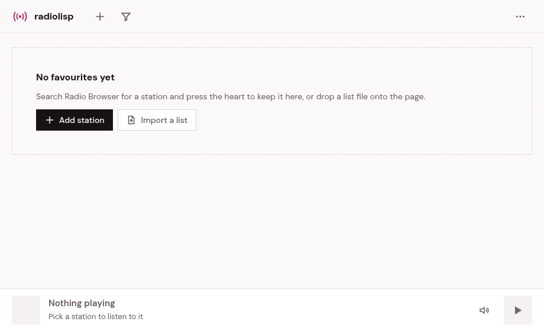

# [radiolisp](https://haztecaso.github.io/radiolisp/)

Radiolisp is a small, fast radio player for the browser: search the whole
[Radio Browser](https://radio-browser.info) directory, keep your favourite
stations in a grid, and give each one its own key. No account, no tracking,
nothing to install, though you can install it as an app if you like.

Inspired by [radiolise](https://radiolise.com), and born as a way to learn
Clojure.

**Try it at <https://haztecaso.github.io/radiolisp/>.** That copy is the
frontend alone, a static website. Almost everything works there; what needs a
server, *now playing* and the proxy for stations that only stream over
`http://`, is only available when you [host it yourself](SELFHOSTING.md) with
the backend.

> **Made with LLMs.** Most of the code, tests and documentation were written by
> a language model (Claude, through Claude Code), following my directions and
> reviewed by me. Expect odd choices and rough edges; issues and pull requests
> are welcome.

## Features

- **Favourites in a grid.** Reorder them by dragging, filter them with `/`, and
  give each station its own key to start it.
- **The whole directory a key away.** Press `a` to search all of Radio Browser;
  with no query it shows what is most played today.
- **Plays almost anything:** MP3, AAC, Ogg and HLS, with the system media keys.
- **Keyboard first.** Arrow keys or vim-style shortcuts everywhere; press `?`
  for the list.
- **Your list is yours.** Export it as M3U or as a list of station ids, import
  those files or a radiolise export, by menu or by dropping the file on the page.
- **Installable**, with an offline shell, and light and dark themes.
- **Twelve languages:** Spanish, English, Portuguese, French, Italian, Catalan,
  Galician, Basque, Romanian, Bulgarian, Russian and Chinese.
- **With the backend:** the title of the song on air, in the player and in the
  system media controls, and a proxy for `http://` stations.

## Privacy

Everything radiolisp remembers (your favourites, their keys, the theme) stays in
your browser's `localStorage`; there are no accounts and no analytics. The app talks to
Radio Browser to search and to the stations to play them; when you play or
vote for a station, Radio Browser counts it, as every client of the directory
does. The optional backend keeps nothing about you either: it never logs IP
addresses, and it is not an open proxy. It only connects to stream URLs it
looked up itself in Radio Browser from a station id, and never to private
addresses, not even after a redirect.

## Known limitations

- **Stations that only stream over `http://`.** Browsers block them on an
  `https` page. Radiolisp tries the `https://` address first and then the
  backend's proxy; without the backend, or for HLS stations, it tells you the
  station cannot be played here.
- **Region blocks.** Some stations refuse listeners from certain countries or
  VPNs. When the station allows it, radiolisp tells you that is what happened.
- **Favourites live in one browser.** To take them to another one, export and
  import them; the keys you assigned do not travel.
- **Now playing** needs the backend and a station that broadcasts titles. HLS
  stations do not show them yet.

## Self-hosting

Radiolisp comes in two flavours: the frontend alone, a static website you can
serve from anywhere, and the frontend with its backend, a single Java process
that adds now playing and the proxy. [SELFHOSTING.md](SELFHOSTING.md) explains
how to build and run both.

## Contributing

Issues and pull requests are welcome. [CONTRIBUTING.md](CONTRIBUTING.md) covers
the development environment, the tasks, how the code is organised and how the
tests work.

## License

[MIT](LICENSE).

## Credits

- Inspired by [radiolise](https://radiolise.com).
- Station data: [Radio Browser](https://radio-browser.info), a community
  project.
- Typeface: [DM Sans](https://github.com/googlefonts/dm-fonts), under the SIL
  Open Font License 1.1 (`frontend/resources/public/fonts/OFL.txt`).
